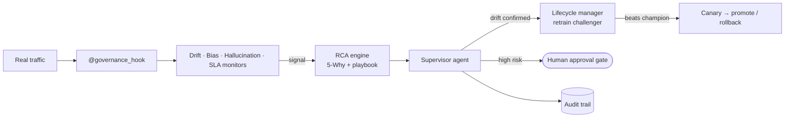
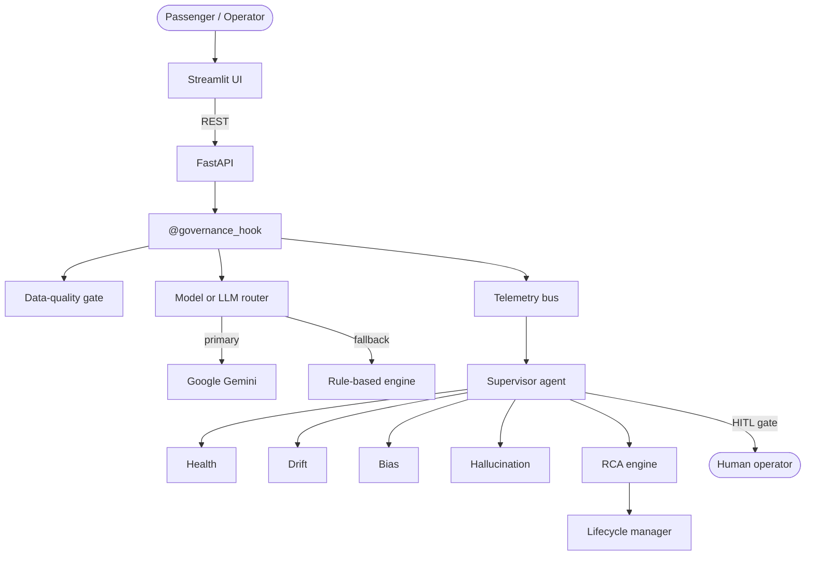

<div align="center">

# 🚆 Railway Buddy

### AI-Powered Intelligent Railway Travel & Autonomous AI Governance Platform

**[🌐 Live Demo → ai-railway-governance.streamlit.app](https://ai-railway-governance.streamlit.app)**

*Seven AI services for Indian Railways passengers, watched over by an autonomous "AI-monitoring-AI" governance layer.*

[](https://ai-railway-governance.streamlit.app)
[](https://www.python.org/)
[](#-api-reference)
[](#-llm-layer--gemini-first-never-crashes)
[](#-testing)

[Live Demo](https://ai-railway-governance.streamlit.app) ·
[Screenshots](#-screenshots) ·
[Architecture](#-architecture) ·
[Quick Start](#-quick-start) ·
[API](#-api-reference) ·
[Governance](#-the-ai-governance-layer)

</div>

---

## 📑 Table of Contents

1. [Overview](#-overview)
2. [Live Demo & Evaluator Walkthrough](#-live-demo--evaluator-walkthrough)
3. [Screenshots](#-screenshots)
4. [Passenger AI Services](#-passenger-ai-services)
5. [The AI Governance Layer](#-the-ai-governance-layer)
6. [Architecture](#-architecture)
7. [LLM Layer — Gemini-first, never crashes](#-llm-layer--gemini-first-never-crashes)
8. [Quick Start](#-quick-start)
9. [Configuration](#-configuration)
10. [Deployment](#-deployment)
11. [API Reference](#-api-reference)
12. [Model Performance & Honest Limitations](#-model-performance--honest-limitations)
13. [Synthetic Dataset](#-synthetic-dataset)
14. [Testing](#-testing)
15. [Project Structure](#-project-structure)
16. [Technology Stack](#-technology-stack)
17. [Extending the Platform](#-extending-the-platform)
18. [Author](#-author)

---

## 🎯 Overview

**Railway Buddy** is a dual-plane AI platform:

| Plane | What it is | Where |
|---|---|---|
| **Passenger plane** | Seven AI services for travellers — ticket confirmation, train recommendation, delay forecast, an agentic travel planner, fare forecast, multilingual support and fraud/bot shielding. | Streamlit *Railway Buddy* pages · `/api/v1/*` |
| **Governance plane** | A *Control Tower* in which autonomous agents monitor every model for health, drift, bias and hallucination, diagnose faults with root-cause analysis, retrain models and roll back — logging every action. | Streamlit *Governance Control Tower* · `/api/v1/governance/*` |

### Design principles

| Principle | How it is implemented |
|---|---|
| **Explainable** | SHAP reasons and confidence on every prediction; faithfulness score on every chat answer. |
| **Governed by default** | A `@governance_hook` decorator wraps every module; real request traffic feeds the drift, fairness, hallucination and SLA monitors. |
| **Human in the loop** | The travel planner never books anything without an explicit approval; high-risk governance actions go through an approval gate. |
| **Never crashes** | Gemini → model chain → rule-based engine; the app works with no API key at all. |
| **Self-contained** | Deterministic synthetic data (`seed=42`) and in-repo model training — nothing to download. |

---

## 🌐 Live Demo & Evaluator Walkthrough

**Live app: [https://ai-railway-governance.streamlit.app](https://ai-railway-governance.streamlit.app)** — no sign-in, no setup.

> The first load may take a few seconds while the platform warms up and pushes a little real traffic through the models so every governance panel has live data.

A suggested 3-minute tour:

| # | Where | Try this | What to look for |
|---|---|---|---|
| 1 | **Home** | Open the app | Live platform status and governance score pulled from the Control Tower. |
| 2 | **Ticket Confirmation** | Predict a waitlisted ticket | Probability, verdict, SHAP "why", governance badge. |
| 3 | **AI Travel Planner** | *"I want to travel from Pune to Delhi tomorrow under ₹1500 and reach before 10:00 AM."* | Agent plan with pros/cons, then the **human approval gate**. |
| 4 | **Support Assistant** | Click *Refund on waitlist ticket*, or ask in Hindi / Hinglish | Grounded answer, language detection, faithfulness score, sources. |
| 5 | **Governance Control Tower** | Press **Normal traffic**, then **Shifted traffic** in the *Chaos lab* | Drift detected → incident with 5-Why root cause → retraining queued → supervisor action log. |
| 6 | **Control Tower → Model lifecycle** | **Retrain now**, then **Promote challenger** | Real training run, champion-vs-challenger comparison, hot-swap into serving. |

---

## 📸 Screenshots

| Home | Ticket Confirmation |
|---|---|
|  |  |

| AI Travel Planner (human-in-the-loop) | Support Assistant |
|---|---|
|  |  |

**Governance Control Tower — one scrollable page**


---

## 🚆 Passenger AI Services

| # | Service | Endpoint | Model / method | Governance |
|---|---|---|---|---|
| 1 | **Ticket Confirmation** | `POST /api/v1/predict/ticket` | XGBoost + SHAP; berth estimator | Rolling accuracy, drift, fairness (DIR) |
| 2 | **Train Recommender** | `POST /api/v1/recommend/trains` | Persona-weighted multi-factor scoring | Disparate-impact audit on top-3 |
| 3 | **Delay & Disruption** | `POST /api/v1/predict/delay` | LightGBM + confidence interval | KS-test / PSI drift on congestion features |
| 4 | **AI Travel Planner** | `POST /api/v1/agent/plan` · `/confirm` · `/reject` | Multi-tool agent + **HITL gate** | Prompt-injection scan, full execution trace |
| 5 | **Fare Forecast** | `POST /api/v1/predict/fare` | XGBoost 30-day trajectory | Anomaly flag, MAPE tracking |
| 6 | **Support Assistant** | `POST /api/v1/support/query` | RAG over IRCTC policy text + Gemini | Faithfulness / hallucination monitor |
| 7 | **Fraud & Bot Shield** | `POST /api/v1/security/score` | XGBoost session-risk classifier | Live confusion-matrix tracking |

<details>
<summary><b>Service details</b></summary>

**1 · Ticket Confirmation** — Predicts whether a waitlist/RAC ticket will clear. Output: probability, verdict (Likely confirmed / Borderline / Likely waitlisted), berth hint and SHAP feature contributions.

**2 · Train Recommender** — `Score = w₁·(1/Fare) + w₂·Punctuality + w₃·Availability + w₄·Duration + w₅·Comfort + w₆·PersonaMatch`. Personas: budget, business, family, senior, tourist. The governance layer audits whether budget trains are under-represented in the top results.

**3 · Delay & Disruption** — Predicts delay minutes with a confidence interval, congestion level and alternative trains when the delay is large.

**4 · AI Travel Planner** — Pipeline: *security scan → constraint parsing (stations, date, budget, class, arrival cut-off) → route search → fare, confirmation-odds and delay tools → ranking → approval gate*. Nothing is booked until the passenger approves; rejecting triggers a re-plan.

**5 · Fare Forecast** — 30-day fare curve, best day to book, demand level (Low / Medium / High / Surge) and SHAP fare drivers.

**6 · Support Assistant** — English, हिन्दी and Hinglish (auto-detected). Pipeline: language detection → glossary-assisted TF-IDF retrieval over `irctc_policies.txt` and `railway_faq.txt` → Gemini answer constrained to the retrieved text → faithfulness check → disclaimer if weakly grounded.

**7 · Fraud & Bot Shield** — Scores a session (request rate, PNR-attempt velocity, Tatkal-window behaviour, CAPTCHA failures, bulk-booking pattern) as safe / suspicious / high-risk / bot with a mitigation note.

</details>

---

## 🛡️ The AI Governance Layer

The **Governance Control Tower** is a single scrollable page — *Needs attention → Pillars → Incidents → Health → Drift → Fairness → Hallucination → Lifecycle → Supervisor → Reports → Chaos lab* — with a sticky section navigator. Each section answers *"what is wrong, why, and what has been done about it?"*

| Pillar | Module | What it does |
|---|---|---|
| 📊 **Model health** | `health_monitor.py` | P50/P95/P99 latency, error rate, **circuit breaker** (closed → open → half-open), SLA: P95 < 3000 ms, errors < 5 %. |
| 🧪 **Data quality** | `data_quality_gate.py` | Pre-inference schema, range and z-score validation against training baselines. |
| 📉 **Drift** | `drift_detector.py` | Per-feature **KS test** and **PSI** (stable < 0.10 · warning < 0.20 · critical ≥ 0.20) over rolling windows of real traffic. |
| ⚖️ **Bias & fairness** | `bias_auditor.py` | **Disparate Impact Ratio** (80 % rule), **Demographic Parity** gap and **Equal Opportunity** gap per protected group. |
| 🧠 **Hallucination guard** | `hallucination_monitor.py` | Scores answers by how much of their content and every number is supported by the retrieved policy text; weak answers are flagged / quarantined. |
| 🚨 **Root-cause analysis** | `rca_engine.py` | De-duplicated incidents, **5-Why** reasoning, causal dependencies and prioritised remediation playbooks. |
| 🔄 **Model lifecycle** | `lifecycle_manager.py` | Version registry, **real retraining**, champion/challenger comparison, canary, **hot-swap promotion and rollback**. |
| 🤖 **Supervisor agent** | `supervisor_agent.py` | 30-second autonomous loop over every pillar; opens incidents, queues retraining, triggers rollback; approval gate for high-risk actions; full audit trail. |

Supporting pieces: `telemetry_bus.py` (thread-safe event bus), `hooks.py` (`@governance_hook`), `report_generator.py` (JSON + Markdown audit reports).

### The autonomous loop



**Real retraining, honestly reported.** `POST /api/v1/governance/lifecycle/retrain` trains a challenger with the project's own pipeline on a fresh split, evaluates it on held-out data and registers it as a canary **only if it beats the production champion** (otherwise it is recorded as *rejected*). `POST …/lifecycle/promote` hot-swaps the served model; the supervisor can also trigger retraining on its own (10-minute cooldown per model). Rule-based services (planner, support assistant) have no weights and are reported as *not applicable* rather than faked.

### Chaos & traffic lab

| Action | Injects | Governance response |
|---|---|---|
| **Normal traffic** | Realistic requests through the live API | Baseline health, drift and fairness data |
| **Shifted traffic** | Requests with a changed feature distribution | Drift on affected models → incidents → retraining queue |
| `latency_spike` | 5 000 ms responses | SLA breach → incident with root cause |
| `error_surge` | Consecutive failures | Circuit opens, auto-recovery probe |
| `drift_simulation` | Synthetic drift event | Retraining queued, supervisor logs the action |

---

## 🏗️ Architecture

```
┌──────────────────────────────────────────────────────────────────────────┐
│                         STREAMLIT  (Railway Buddy)                        │
│   Home · Ticket · Trains · Delay · Planner · Fares · Support · Security   │
│                    └──────── Governance Control Tower ────────┘           │
└───────────────────────────────┬──────────────────────────────────────────┘
                                │ REST
┌───────────────────────────────▼──────────────────────────────────────────┐
│                           FASTAPI  /api/v1/*                              │
│  M1 Ticket │ M2 Trains │ M3 Delay │ M4 Planner │ M5 Fare │ M6 Support │ M7 │
│                 every service wrapped by @governance_hook                 │
└──────────┬─────────────────────────────────────────────────┬─────────────┘
           │ telemetry (latency · schema · confidence · features)             │
┌──────────▼─────────────────────────────────┐    ┌──────────▼─────────────┐
│          GOVERNANCE TELEMETRY BUS           │    │       LLM ROUTER        │
└──────────┬─────────────────────────────────┘    │ Gemini model chain      │
           │                                      │   ↓ (any failure)       │
┌──────────▼─────────────────────────────────┐    │ Rule-based engine       │
│  Health · Data quality · Drift · Bias ·     │    └────────────────────────┘
│  Hallucination · RCA · Lifecycle ·          │
│  Supervisor agent  →  Reports / Audit trail │
└─────────────────────────────────────────────┘
```



On Streamlit Cloud both tiers run in **one container**: `streamlit_app.py` starts FastAPI on `127.0.0.1:8000` in a daemon thread, waits for health, then hands control to the Streamlit app.

---

## 🤖 LLM Layer — Gemini-first, never crashes

The Support Assistant is answered by **Google Gemini**, constrained to retrieved IRCTC policy text. The router (`core/llm_router.py`) calls Gemini over plain HTTPS (no SDK to break) and is built so that the app **never errors out**:

```
GEMINI_MODEL (if current)  →  gemini-3.5-flash-lite  →  gemini-3.1-flash-lite  →  gemini-3.8-flash  →  rule-based engine
```

- Retired models (`gemini-1.0 / 1.5 / 2.0`) are skipped automatically.
- A `404` or `429` puts only that model on a cooldown; the next one in the chain answers.
- If every model fails (no key, network, quota) the **rule-based engine answers** — same endpoints, same schema.
- Every answer, whichever engine produced it, is scored by the hallucination monitor.
- The live engine is shown in the sidebar and in `GET /api/health → llm`.
- Azure OpenAI remains available as an optional secondary provider.

All predictive models (M1–M3, M5, M7) run locally — they never call a cloud API.

---

## ⚡ Quick Start

**Prerequisites:** Python 3.11 (3.10+ works) and roughly 2 GB of disk space.

```bash
git clone https://github.com/JEEVANPRAKASHKV/ai-railway-autonomous-governance.git
cd ai-railway-autonomous-governance
pip install -r requirements.txt

python run_platform.py        # generates data, trains models if missing, starts API + UI
```

| Service | URL |
|---|---|
| Railway Buddy (Streamlit) | http://localhost:8501 |
| FastAPI backend | http://localhost:8000 |
| Interactive API docs (Swagger) | http://localhost:8000/docs |

No API key is required — without one the platform runs on its rule-based engine. To enable Gemini, copy `.env.example` to `.env` and set `GEMINI_API_KEY`.

---

## ⚙️ Configuration

Configuration is read from environment variables / `.env` (locally) or **Secrets** (Streamlit Cloud).

| Variable | Default | Purpose |
|---|---|---|
| `GEMINI_API_KEY` | — | Enables Gemini for the Support Assistant. Free key: [aistudio.google.com/app/apikey](https://aistudio.google.com/app/apikey). |
| `GEMINI_MODEL` | `gemini-3.5-flash-lite` | First model tried; the rest of the chain follows automatically. |
| `AZURE_OPENAI_ENDPOINT` / `_KEY` / `_DEPLOYMENT_NAME` | — | Optional secondary provider. |
| `BACKEND_URL` | `http://127.0.0.1:8000` | Where the UI finds the API. |
| `RANDOM_SEED` | `42` | Deterministic data generation and training. |
| `GOVERNANCE_ALERT_THRESHOLD_P95_LATENCY_MS` | `3000` | SLA latency threshold. |
| `GOVERNANCE_DRIFT_PSI_THRESHOLD` | `0.15` | PSI drift threshold. |
| `GOVERNANCE_BIAS_DIR_THRESHOLD` | `0.80` | Disparate-impact threshold. |
| `GOVERNANCE_HALLUCINATION_THRESHOLD` | `0.65` | Faithfulness threshold. |

> Never commit real keys. `.env` is git-ignored; use Secrets for cloud deployments.

---

## ☁️ Deployment

### Streamlit Community Cloud (used for the live demo)

1. Sign in at [share.streamlit.io](https://share.streamlit.io/) with GitHub and choose **New app**.
2. Repository `JEEVANPRAKASHKV/ai-railway-autonomous-governance`, branch `main`, **main file `streamlit_app.py`**.
3. *(Optional)* **Advanced settings → Secrets**:
   ```toml
   GEMINI_API_KEY = "your-gemini-api-key"
   GEMINI_MODEL = "gemini-3.5-flash-lite"
   ```
4. Deploy. The root entrypoint boots FastAPI and Streamlit together; pre-trained artifacts are tracked in the repo for an instant cold start.

### Render (Web Service)

| Setting | Value |
|---|---|
| Build command | `pip install -r requirements.txt` |
| Start command | `streamlit run streamlit_app.py --server.port $PORT --server.address 0.0.0.0 --server.headless true` |
| Environment | `PYTHONUNBUFFERED=1` (+ optional Gemini variables) |

---

## 📡 API Reference

Interactive documentation is served at `/docs`. Health: `GET /api/health` (includes the live LLM status).

### Passenger APIs

| Method | Endpoint | Service |
|---|---|---|
| POST | `/api/v1/predict/ticket` | Ticket Confirmation |
| POST | `/api/v1/recommend/trains` | Train Recommender |
| POST | `/api/v1/predict/delay` | Delay & Disruption |
| POST | `/api/v1/agent/plan` | Travel Planner — create plan (stops at approval gate) |
| POST | `/api/v1/agent/confirm` · `/api/v1/agent/reject` | Travel Planner — approve / reject |
| GET | `/api/v1/agent/request/{request_id}` | Travel Planner — request status |
| POST | `/api/v1/predict/fare` | Fare Forecast |
| POST | `/api/v1/support/query` | Support Assistant |
| POST | `/api/v1/security/score` | Fraud & Bot Shield |

### Governance APIs (`/api/v1/governance/…`, 35 endpoints)

| Area | Endpoints |
|---|---|
| **Supervisor** | `GET /supervisor/dashboard` · `GET /supervisor/actions` · `POST /supervisor/report` · `POST /supervisor/chaos` · `POST /supervisor/rollback` · `GET /supervisor/hitl/pending` · `POST /supervisor/hitl/decide` · `POST /supervisor/reset` |
| **Health** | `GET /health/platform` · `GET /health/module/{id}` · `GET /health/sla` |
| **Drift** | `GET /drift/all` · `GET /drift/model/{id}` · `GET /drift/history` |
| **Bias** | `GET /bias/audit/all` · `GET /bias/audit/{module}` · `GET /bias/history` |
| **Hallucination** | `GET /hallucination/stats` · `GET /hallucination/recent` |
| **Incidents / RCA** | `GET /incidents/open` · `GET /incidents/summary` · `GET /incidents/{id}` · `POST /incidents/{id}/resolve` |
| **Lifecycle** | `GET /lifecycle/platform` · `GET /lifecycle/model/{id}` · `POST /lifecycle/retrain` · `POST /lifecycle/promote` · `GET /lifecycle/retraining-queue` |
| **Reports & telemetry** | `GET /reports/history` · `GET /reports/{id}` · `POST /telemetry/seed` · `GET /telemetry` |

<details>
<summary><b>Example: plan a journey, then approve it</b></summary>

```bash
curl -X POST http://localhost:8000/api/v1/agent/plan \
  -H "Content-Type: application/json" \
  -d '{"query": "Travel from Pune to Delhi tomorrow under 1500, reach before 10:00 AM"}'

curl -X POST http://localhost:8000/api/v1/agent/confirm \
  -H "Content-Type: application/json" \
  -d '{"request_id": "PLAN-XXXXXXXX", "selected_option_id": "OPT-1"}'
```
</details>

---

## 📊 Model Performance & Honest Limitations

Training data is **synthetic**, so these metrics describe the simulator — not real Indian Railways traffic. They are published as measured, and the confidence shown to passengers reflects them.

| Model | Held-out metric | Reading |
|---|---|---|
| Fare predictor | R² 0.9997 · MAPE 0.93 % | Near-perfect because fares are formula-derived in the synthetic data. |
| Fraud detector | Accuracy 0.9995 | Synthetic classes are cleanly separable; expect lower on real traffic. |
| WL/RAC ticket predictor | Accuracy 0.616 (3 classes) | Modest — probability is shown with its uncertainty. |
| Delay predictor | MAE 14.7 min · R² 0.15 | Weak signal — presented as a forecast with an interval, not a promise. |
| Berth estimator | Accuracy 0.277 | Close to chance — shown as a hint only. |

**Other limitations**

- The planner searches the bundled synthetic timetable; it does not query live IRCTC data and never books real tickets.
- The Gemini free tier is rate-limited; when it is exhausted the rule-based engine answers instead.
- The governance state is held in memory and resets when the container restarts.

---

## 🗂️ Synthetic Dataset

Generated deterministically (`RANDOM_SEED=42`) by `data/generate_synthetic_data.py` — reproducible on any machine.

| Dataset | Rows | Description |
|---|---|---|
| `trains.csv` | 500 | Routes, classes and quota types |
| `stations.csv` | 200 | Stations with zone, tier and baseline congestion |
| `pnr_history.csv` | 50,000 | WL / RAC / confirmed records with final status |
| `pricing_history.csv` | 100,000 | Fare-date-class records with dynamic curves |
| `user_profiles.csv` | 5,000 | Six personas: budget, premium, student, senior, business, family |
| `congestion_logs.csv` | 73,000 | 365 days × 200 stations congestion index |
| `delay_logs.csv` | 200,000 | Historical delay per train per station |
| `fraud_events.csv` | 10,000 | Labelled sessions (80 % legitimate, 5 % bot, 15 % suspicious) |
| `irctc_policies.txt` | ~3,000 lines | Cancellation, refund, Tatkal and waitlist policies (RAG corpus) |
| `railway_faq.txt` | 500 Q&A | PNR, refund and booking queries (RAG corpus) |

---

## 🧪 Testing

```bash
pytest -q          # 40 tests: data generator, modules, governance pillars, LLM router, API
```

Notable coverage: governance pillars and the supervisor, idempotent incident handling (RCA de-duplication), lifecycle retraining behaviour, the Gemini model-chain / cooldown / fallback logic (network stubbed), and end-to-end API contracts.

---

## 📁 Project Structure

```
ai-railway-autonomous-governance/
├── streamlit_app.py            # Cloud entrypoint: starts FastAPI + Streamlit in one container
├── run_platform.py             # Local single-command launcher
├── requirements.txt · runtime.txt · .env.example
│
├── frontend/                   # Railway Buddy UI
│   ├── app.py                  #   navigation shell, branding, warm-up
│   ├── ui.py                   #   blue/white design system, API helpers, charts
│   ├── passenger.py            #   Home + the seven passenger services
│   ├── tower.py                #   single-page Governance Control Tower
│   ├── components/             #   SHAP chart, telemetry badge
│   └── assets/                 #   logo and icon
│
├── backend/                    # FastAPI
│   ├── main.py · middleware.py · dependencies.py
│   └── routers/                #   ticket · recommend · delay · planner · fare · support · fraud · governance
│
├── modules/                    # The seven AI services
│   ├── m1_ticket_predictor/    ├── m2_train_recommender/   ├── m3_delay_predictor/
│   ├── m4_travel_planner/      ├── m5_fare_predictor/      ├── m6_support_assistant/
│   └── m7_fraud_detector/
│
├── governance/                 # The governance layer
│   ├── telemetry_bus.py · hooks.py · data_quality_gate.py
│   ├── health_monitor.py · drift_detector.py · bias_auditor.py · hallucination_monitor.py
│   ├── rca_engine.py · lifecycle_manager.py · report_generator.py · supervisor_agent.py
│   └── reports/
│
├── core/                       # config, schemas, llm_router.py (Gemini chain), fallback_engine.py
├── models/                     # train_all_models.py, artifacts/, registry/model_registry.json
├── data/                       # synthetic data generator + generated datasets
├── docs/screenshots/           # README images
└── tests/                      # pytest suite
```

---

## 🛠️ Technology Stack

| Layer | Technology |
|---|---|
| **Frontend** | Streamlit (multipage navigation, fragments) · Plotly · custom blue/white design system |
| **Backend** | FastAPI · Uvicorn · Pydantic v2 · pydantic-settings |
| **ML** | XGBoost · LightGBM · scikit-learn · imbalanced-learn |
| **Explainability** | SHAP (TreeExplainer per model) |
| **Drift & statistics** | SciPy (KS test) · PSI · NumPy · Pandas |
| **LLM** | Google Gemini (REST, model chain) · optional Azure OpenAI · TF-IDF RAG · rule-based fallback |
| **Governance** | Custom telemetry bus, circuit breaker, RCA engine, lifecycle manager, supervisor agent |
| **Language handling** | Devanagari and Hinglish detection with a Hindi/Hinglish → English retrieval glossary |

---

## 🧩 Extending the Platform

Adding a new AI service takes four steps, and **no governance code needs to change**:

1. Create `modules/m8_new_module/service.py`.
2. Decorate the entry point with `@governance_hook("m8_new_module", endpoint="/api/v1/…")`.
3. Add `backend/routers/new_module.py` and include it in `backend/main.py`.
4. Add a page function in `frontend/passenger.py` and register it in `frontend/app.py`.

The telemetry bus, health, drift, fairness and incident pipelines pick the new module up automatically.

---

## 👤 Author

**Jeevan Prakash K V**
Repository: [github.com/JEEVANPRAKASHKV/ai-railway-autonomous-governance](https://github.com/JEEVANPRAKASHKV/ai-railway-autonomous-governance)
Live demo: [ai-railway-governance.streamlit.app](https://ai-railway-governance.streamlit.app)

<sub>Built as a reference architecture for governed, explainable AI in public-transport services. All data is synthetic; no real passenger information is used.</sub>
